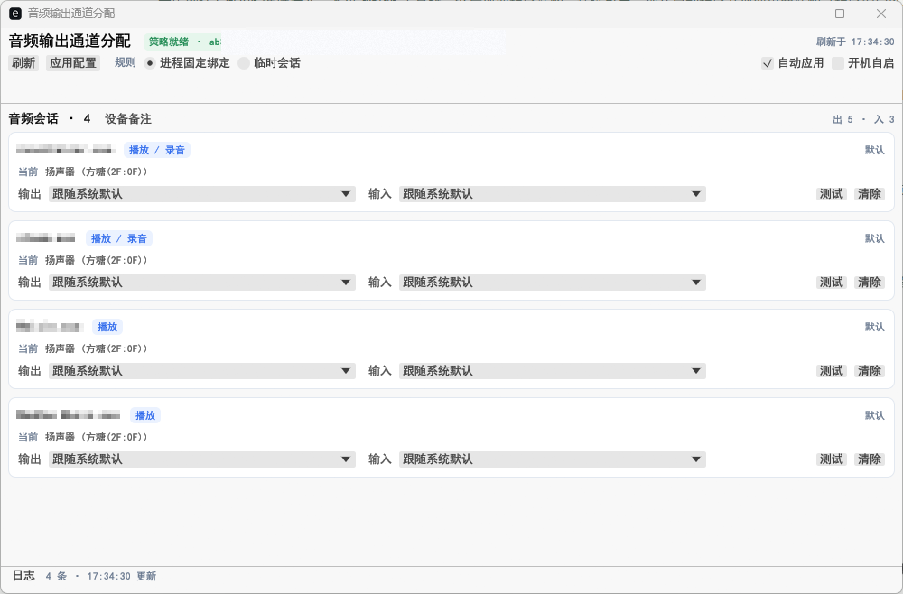

# 音频输出通道分配 · AudioRouteAssign

为 Windows 上的每一个应用，单独指定音频输出与输入设备。单个 exe，双击即用，常驻托盘。

## 功能

| 能力 | 说明 |
| --- | --- |
| 会话枚举 | 列出已建立音频会话的进程（含当前未播放的，以「待机」区分），区分播放与录音 |
| 独立设备 | 每个进程分别选择输出设备与输入设备，互不影响 |
| 设备列表 | 列出系统声卡与虚拟声卡（VB-Cable、VoiceMeeter 等）的设备名称 |
| 配置保存 | `进程 → 输入/输出设备` 映射自动保存，启动即加载 |
| 两种模式 | **进程固定绑定**：按 exe 路径长期生效；**临时会话**：改动只作用于当前会话，退出程序时还原 |
| 会话备注 | 每条会话一个备注，显示在进程名后 |
| 配置分组 | 「+ 新建分组」建组；成员折叠进组卡；输出/输入/音量三列与条目卡片对齐；底部一行展开/收起并显示收起项摘要 |
| 条目常驻 | 出现过的应用都保留卡片，进程退出也不会消失；可归入「无用」隐藏，列表头部一键显示 |
| 置顶排序 | 会话用 ☆/★ 置顶并优先排序；分组可置顶、可折叠 |
| 音量控制 | 每个应用一条独立音量滑块，与系统音量合成器同一份状态 |
| 音量档位 | 0%~100% 档位下拉（10% 步进）快速切换，滑块微调 |
| 一键静音 | 点击喇叭图标立即闭麦 / 恢复 |
| 音量固化 | 勾选「默认」把当前音量写入配置，下次启动或会话重建时自动套用 |
| 托盘常驻 | 关闭窗口收进托盘；左键单击或双击打开主窗口；右键菜单：打开窗口、应用配置、仅音量模式、退出 |
| 严格单实例 | 再次双击 exe 只把已运行实例调回前台，不启动第二份进程 |
| 开机自启 | 界面开关控制 |
| 测试播放 | 每个会话与每个分组各有测试音按钮，可试听目标输出设备 |
| 应用图标 | 显示进程真实图标，提取失败回退首字母 |
| 权限模式 | 默认完整模式；托盘勾选「仅音量模式」后重启不再提权，仅音量控制可用 |
| 日志面板 | 顶部浮层，按「总 / 信息 / 警告 / 错误」标签分流 |

## 下载与运行

从 [Releases](../../releases/latest) 下载 `audio-route-assign.exe`，双击运行。

- 单文件，下载即用，无需安装
- 启动弹出 UAC：修改音频路由需要管理员权限；只调音量时可在托盘勾选「仅音量模式」，重启后不再提权
- 同一时刻只保留一份：已在运行时再次双击，只唤出原窗口
- 配置文件：`%LOCALAPPDATA%\AudioRouteAssign\config.json`
- 启动日志：`%LOCALAPPDATA%\AudioRouteAssign\startup.log`

## 使用流程

1. 启动程序并确认 UAC 提权
2. 在「音频会话」中选择目标进程，未出声但已建立会话的程序显示为「待机」
3. 在「输出」下拉框选择目标声卡；录音应用同样设置「输入」
4. 点击「应用配置」
5. 拖动滑块调音量，点击喇叭图标静音；勾选「默认」把该音量记入配置
6. 需要长期生效切到「进程固定绑定」，只想临时调整留在「临时会话」
7. 多个程序统一设置：点「+ 新建分组」，再在各卡片的「分组」下拉里选择该组

## 已知限制

- 仅支持 Windows 10 / 11 x64
- 需要管理员权限，普通权限下无法修改音频路由
- 路由在应用建立音频会话时生效，已在运行的应用通常需要重启

## 免责声明

本软件按「现状」（AS IS）提供，不附带任何明示或暗示的担保；不联网、不上传数据、无遥测。

使用本软件可能导致应用音频被路由到非预期设备、应用无声或系统音频策略被修改，通常可通过「清除」按钮或在系统声音设置中恢复默认设备消除。在**任何情况下**，作者与贡献者均不对因使用或无法使用本软件而产生的任何直接、间接、偶然、特殊或后果性损害承担责任，包括但不限于数据丢失、业务中断、设备损坏或利润损失。生产环境、直播、录音等关键场景请先自行验证。

请仅从本仓库 Releases 页面下载。Windows 是 Microsoft Corporation 的注册商标，本项目与 Microsoft 无任何关联，未获其背书或认证。

## 版权

[MIT License](LICENSE) © 2026 lindagao
